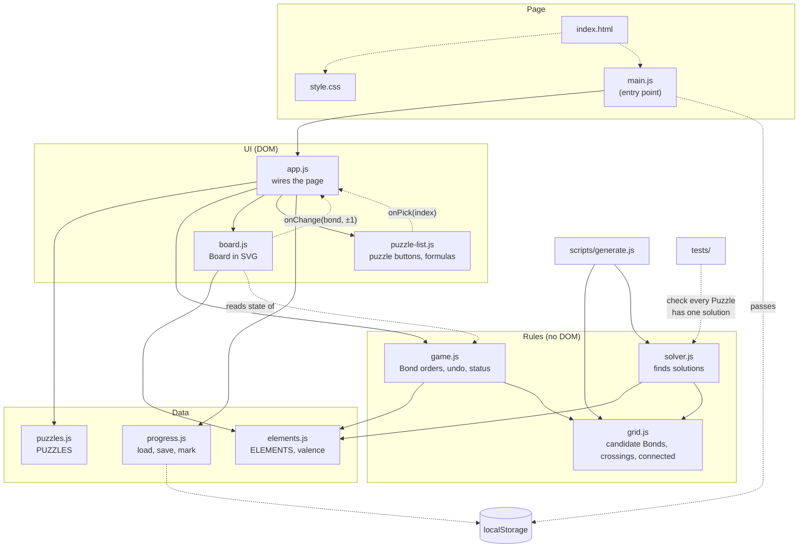

# Molecuzzle

A puzzle game in the browser where you bond atoms on a grid until they form a real molecule; plain JavaScript, built into one HTML file.

**Play it: <https://treetopbottle.github.io/molecuzzle/>** (built from `main`; a prototype, not reviewed yet)

## Why?

Mission: let people learn how atoms bond, and how many bonds each atom needs, by solving puzzles that turn into real molecules, without installing anything.

Vision: chemistry feels like a puzzle you can solve, not a list of formulas to memorise.

## Who?

Roles, capitalized, each with an example the spec can reuse:

- Player: someone learning or curious about chemistry who plays the Puzzles in a browser, on a computer or phone; Noor, a 15-year-old in a first year of chemistry

## What?

Domain entities, capitalized, each with an example the spec can reuse:

- Element: a kind of atom, with the number of Bonds it needs (its valence); Carbon, 4 Bonds
- Atom: one Element at a point of the Grid; the N at row 4, column 3 in Glycine
- Grid: the rows and columns of points the Atoms of a Puzzle sit on; Glycine's Grid of 4 rows and 5 columns
- Dotted line: where a Bond can go, from an Atom to the nearest Atom in the same row or column; the dotted line from O 1,2 down to H 4,2 in Glycine
- Bond: a link along a Dotted line between two Atoms, single, double or triple; the C=O double Bond in Formaldehyde
- Molecule: Atoms connected by Bonds into one piece; Water
- Puzzle: a Grid with Atoms, whose Bonds can be filled in only one way, into a named Molecule; Puzzle 11, Glycine, C₂H₅NO₂
- Progress: per Puzzle, whether it is solved or its solution was seen, and the open Puzzle; stored in the browser

## Where things are

- [CONTRIBUTING.md](CONTRIBUTING.md): the working agreement
- `src/`: the code, as ES modules: `game.js` (the rules), `grid.js`, `solver.js`, `puzzles.js`, `board.js` (the Board in SVG), `puzzle-list.js`, `progress.js`, `app.js` (wires the page) and `index.html` with `style.css`
- `scripts/`: `build.js` makes `dist/index.html`; `generate.js` finds Grid layouts for new Puzzles; `publish-pages.sh` publishes a build to GitHub Pages
- `.github/workflows/pages.yml`: builds and publishes every branch
- `tests/`: `unit/` (Vitest: rules, components in happy-dom), `ui/` (Playwright, on the built page), `helpers/`
- `prototypes/`: try-outs of other puzzle modes, outside the spec
- [docs/spec/](docs/spec/README.md): the specification for the software, with its schemas
- [docs/decisions.md](docs/decisions.md): any decisions made about the project
- [docs/plans/](docs/plans/README.md): the backlog, including specific plans for implementing features/slices
- [docs/workflow/](docs/workflow/): documentation of the development process

### How `src/` fits together

Solid arrows are imports, dotted arrows are calls at runtime (the page loading files, callbacks, the browser's storage).

`solver.js` is not part of the game itself: `scripts/generate.js` uses it to find new layouts, and the tests use it to check the Puzzles in `puzzles.js`.

## Development

From this folder, with Node.js 22.12 or newer (an even-numbered release):

- Install: `npm install`, and once `npx playwright install chromium`, or set `CHROMIUM_PATH` to a Chromium already installed (e.g. `/usr/bin/chromium`).
- Build: `npm run build` writes `dist/index.html`, the whole game in one file; open it in a browser, no server needed.
- Test: `npm test` (unit and component tests), `npm run test:ui` (UI tests; builds first).
- Check: `npm run check` builds and runs all tests.
- New Puzzle: `node scripts/generate.js "<bonds>"` prints a layout with exactly one solution; see the comment at its top.

## Branch builds

Every push builds `dist/index.html` on GitHub Actions and, if the build succeeds, publishes it to GitHub Pages (via the `gh-pages` branch). The tests don't run there, so a branch build may have failing tests: run `npm run check` before pushing.

- `main`: <https://treetopbottle.github.io/molecuzzle/>
- any other branch: `https://treetopbottle.github.io/molecuzzle/branches/<branch>/`, with characters other than letters, digits, `.`, `_` and `-` replaced by `-` (`feature/x` becomes `feature-x`); all of them are listed at <https://treetopbottle.github.io/molecuzzle/branches/>
- deleting a branch removes its build

Setup, once: after the first run has made the `gh-pages` branch, set Settings → Pages → Source to "Deploy from a branch", branch `gh-pages`, folder `/ (root)`.
