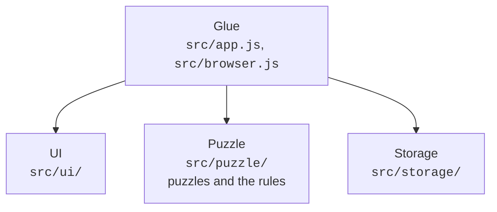

# Molecuzzle

A puzzle game in the browser where you bond atoms on a grid until they form a real molecule; plain JavaScript, built into one HTML file.

**Play it: <https://treetopbottle.github.io/molecuzzle/>** (built from `main`)

## Why?

Mission: create a fun puzzle game with atoms and molecules.

Vision: hundres of puzzles to solve of varying difficulty levels.

## Who?

Roles, capitalized, each with an example the spec can reuse:

- Player: a person playing the game on a browser, using a computer or phone; Tom, a chemist

## What?

Domain entities, capitalized, each with an example the spec can reuse:

- Puzzle: a Grid with Atoms, whose Bonds can be filled in only one way, into a named Molecule; Puzzle 3, Glycine, C₂H₅NO₂
- Element: a type of atom, with the number of Bonds it needs (its valence); Carbon, 4 Bonds
- Atom: a single Element at a point on the Grid, with the hydrogens bonded to it from the start; the C with 2 hydrogens at row 2, column 2 in Glycine
- Molecule: Atoms are connected by Bonds into one molecule; Water H2O
- Grid: the rows and columns of points the Atoms of a Puzzle sit on; Glycine's Grid of 3 rows and 2 columns
- Dotted line: where a Bond can go, from an Atom to the nearest Atom in the same row or column; the dotted line from OH 1,1 to NH₂ 1,2 in Glycine
- Board: a Puzzle being played, with the Bonds the Player has made; Acetic acid with only C═O
- Bond: a link along a Dotted line between two Atoms, single, double or triple; the C=O double Bond in Acetic acid
- Progress: which Puzzles are solved, the open Puzzle, and the Boards of Puzzles in progress or solved; stored in the browser

## Where things are

- [CONTRIBUTING.md](CONTRIBUTING.md): the working agreement
- `src/`: the code, as ES modules: the components `puzzle/`, `storage/` and `ui/`, wired together by `browser.js` and `app.js`; see below
- `scripts/`: the build, publishing to GitHub Pages, the screenshot tests and finding layouts for new Puzzles
- `tests/`: `unit/`, `e2e/`, `helpers/`
- `prototypes/`: try-outs of other puzzle modes, outside the spec
- [docs/spec/](docs/spec/README.md): the specification for the software, with its schemas
- [docs/architecture.md](docs/architecture.md): how the files in `src/` fit together, per component
- [docs/decisions.md](docs/decisions.md): any decisions made about the project
- [docs/plans/](docs/plans/README.md): the backlog, including specific plans for implementing features/slices
- [docs/workflow/](docs/workflow/): documentation of the development process

### How `src/` fits together

The three components ([decision 0011](docs/decisions.md#0011)) and the Glue, `browser.js` and `app.js`, which wires them together and is not a component: it adds nothing of its own. An arrow is an import: the components don't import each other, only the Glue imports them. The files of each component are in [docs/architecture.md](docs/architecture.md).

## Development

Commands are run in this folder, with Node.js 22.12 or newer (an even-numbered release), and Podman (or Docker) for the screenshots:

- Install: `npm install`
- Build: `npm run build` writes `dist/index.html`, the whole game in one file; open it in a browser, no server needed.
- Browser for the end-to-end tests: `npx playwright install chromium`, or set `CHROMIUM_PATH` to a Chromium already installed (e.g. `/usr/bin/chromium`).
- Test: `npm test` (unit and component tests), `npm run test:e2e` (end-to-end tests; builds first), `npm run test:screenshots` (compares the page with `docs/spec/screenshots/`, in Playwright's image; `CONTAINER=docker` to use Docker).
- Screenshots: after an intended change to the look, `npm run test:screenshots -- --update-snapshots` makes them again; look at each in the diff before committing ([decision 0013](docs/decisions.md#0013)).
- Check: `npm run check` builds and runs all tests, the screenshots included.
- New Puzzle: `node scripts/generate.js "<bonds>"` prints a layout with exactly one solution; see the comment at its top.

## Branch builds

Every push builds `dist/index.html` on GitHub Actions and, if the build succeeds, publishes it to GitHub Pages (via the `gh-pages` branch). The tests don't run there, so a branch build may have failing tests: run `npm run check` before pushing.

- `main`: <https://treetopbottle.github.io/molecuzzle/>
- any other branch: `https://treetopbottle.github.io/molecuzzle/branches/<branch>/`, with characters other than letters, digits, `.`, `_` and `-` replaced by `-` (`feature/x` becomes `feature-x`); all of them are listed at <https://treetopbottle.github.io/molecuzzle/branches/>
- deleting a branch removes its build

Setup, once: after the first run has made the `gh-pages` branch, set Settings → Pages → Source to "Deploy from a branch", branch `gh-pages`, folder `/ (root)`.
