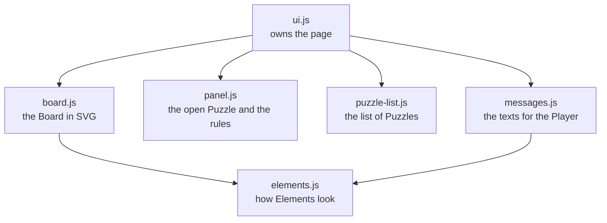
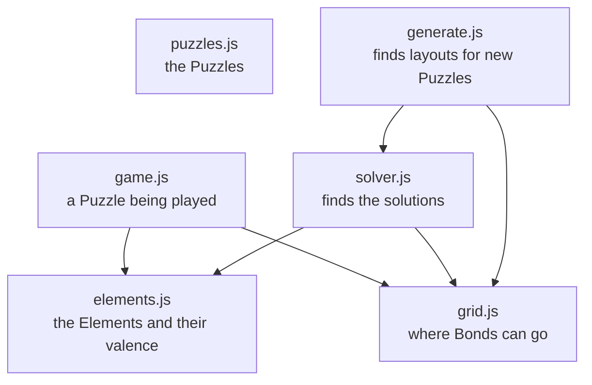

# Architecture

This file describes how the files in `src/` fit together. It is split by component ([decision 0011](decisions.md#0011)) with the addition of Glue that ties it all together.

Each diagram shows the files of one component; an arrow is an import. Arrows are annotated with what happens at runtime (callbacks, the page loading files, the browser's storage).

## Glue

`index.html` is the page and loads `style.css` and `browser.js`; nothing imports them.

## UI

`ui.js` owns all the interface components on the webpage and when the Player does something it calls the handlers provided by `app.js`.

## Puzzle

The Puzzles and the rules. `game.js` keeps the Bonds of a Board and gives its status and the reasons.

`solver.js` and `generate.js` are not part of the game itself: `scripts/generate.js` uses `generate.js` to find new layouts, and the tests use the solver to check the Puzzles in `puzzles.js`.

## Storage

One file, so no diagram: `progress.js` loads and updates the Progress in the storage it is given. `localStorage` is used at the moment.
