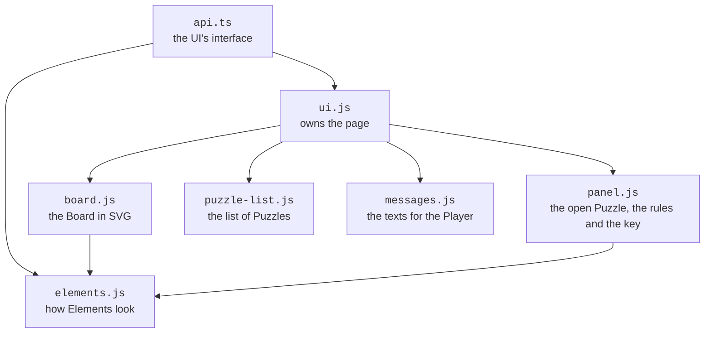
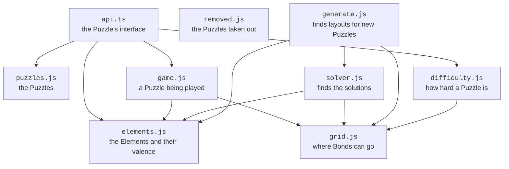

# Architecture

This file describes how the files in `src/` fit together. It is split by component ([decision 0011](decisions.md#0011)) with the addition of Glue that ties it all together.

Each component has an `api.ts`, its interface ([decision 0028](decisions.md#0028)): the types of what it offers and of what it needs from the others, in its own terms, and the values the Glue uses, re-exported. The Glue imports only `app.ts` and the `api.ts` files, and a component imports only from its own folder; `tests/unit/imports.test.ts` checks both.

Each diagram shows the files of one component; an arrow is an import. Arrows are annotated with what happens at runtime (callbacks, the page loading files, the browser's storage). The component's files take their types from its `api.ts`, which the diagrams leave out.

## Glue

`browser.ts` is the only file using the browser's globals: it makes the dependencies and starts `app.ts`, which wires the components together. `app.ts`'s `AppDeps` is what it is given: the Puzzles, `createGame`, the store and `createUi`, each typed by its component's `api.ts`. Where they meet, `tsc` checks that one component's types fit the other's: a game fits the UI's `BoardModel`, the Puzzle's status, counts and change result fit the UI's, a Puzzle and Progress fit what the UI shows of them, and the Puzzle's `Saved` and Storage's `BoardEntry` fit each other both ways. In `browser.ts`, it checks that the UI has a look for each Element of the key.

## UI

`index.html` is the page and loads `style.css` and the Glue's `browser.ts`; nothing imports them.

`ui.js` owns all the interface components on the webpage and when the Player does something it calls the handlers provided by `app.ts`.

`api.ts` offers `createUi` and its `Ui`, the `Handlers` it calls and the `View` it renders; it needs a `BoardModel`, what the Board reads of a game, and the status, counts, change result, Puzzles, Progress and key Elements, in the UI's terms. Its `LookSymbol` is the symbols `elements.js` has a look for, so `tsc` checks that the UI can draw each of the Puzzle's Elements.

## Puzzle

The Puzzles and the rules. `game.js` keeps the Bonds of a Board and gives its status, its counts and budget, and the reasons.

`solver.js`, `generate.js` and `removed.js` are not part of the game itself: `scripts/generate.js` uses `generate.js` to find new layouts and `difficulty.js` to score them, and the tests use the solver and the difficulty to check the Puzzles in `puzzles.js`, and `removed.js`, the Puzzles taken out of the game, to keep them out; the tests check the layouts in both. The Glue's `app.ts` uses `difficulty.js` too, through `api.ts`, for the difficulty the panel shows.

`api.ts` offers the `Puzzle`, the `Game` that `createGame` makes of it, with its status, counts and change result, and `Saved`, where a game was left; and it re-exports `PUZZLES`, `createGame`, `ELEMENTS` and `difficulty`. It needs nothing from the others.

## Storage

Two files, so no diagram: `progress.ts` loads and updates the Progress in the storage it is given. `localStorage` is used at the moment. `api.ts` offers the `Progress`, with its `BoardEntry`s, and the `Store` that `createProgressStore` makes, and `markSolved`; it needs a `KeyValueStorage`, which `localStorage` fits.
