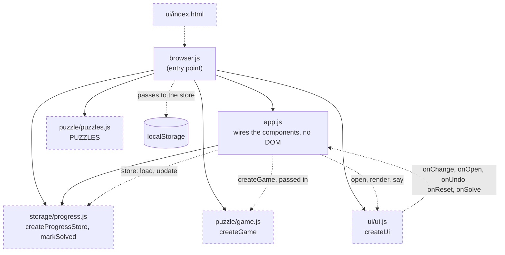
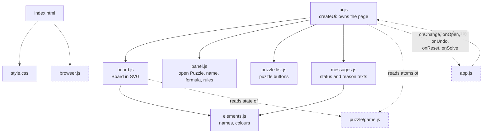
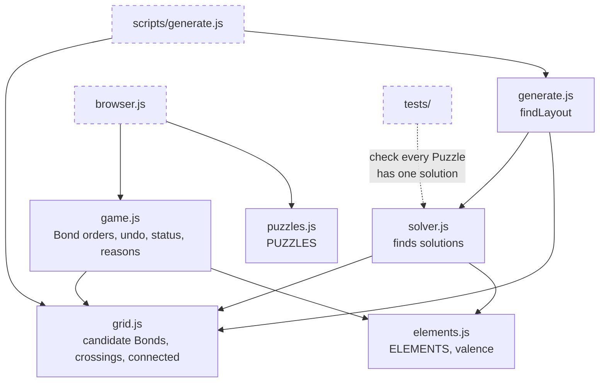
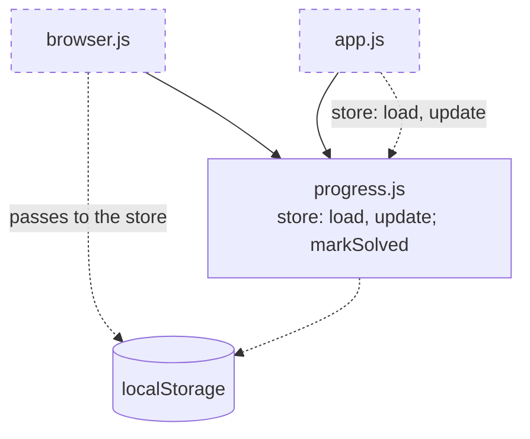

# Architecture

How the files in `src/` fit together, one diagram per component ([0011](decisions.md#0011)). The overview of the components is in the [README](../README.md#how-src-fits-together).

In the diagrams, solid arrows are imports, dotted arrows are calls at runtime (the page loading files, callbacks, the browser's storage), and boxes with a dashed border belong to another component.

## Glue

`browser.js` is the entry point and the only file using the browser's globals: it makes the dependencies and passes them to `startApp` in `app.js`, which wires the components and has no DOM.

## UI

`ui.js` owns the page: it draws the Board, the panel and the list of Puzzles, words every status and reason, and calls the Glue back when the Player does something.

## Puzzle

The Puzzles and the rules, with no DOM. `game.js` keeps the Bonds of a Board and gives its status and the reasons; the rules produce no text for the Player.

`solver.js` and `generate.js` are not part of the game itself: `scripts/generate.js` uses `findLayout` to find new layouts, and the tests use the solver to check the Puzzles in `puzzles.js`.

## Storage

What is kept in the browser: `progress.js` loads and updates the Progress in the storage it is given, `localStorage` in the game.

