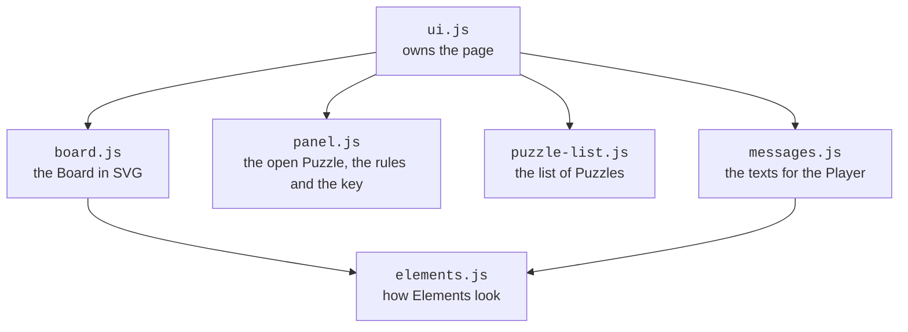
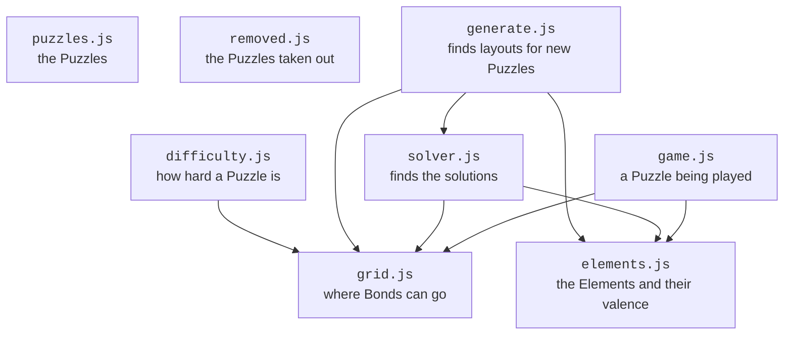

# Architecture

This file describes how the files in `src/` fit together. It is split by component ([decision 0011](decisions.md#0011)) with the addition of Glue that ties it all together.

Each diagram shows the files of one component; an arrow is an import. Arrows are annotated with what happens at runtime (callbacks, the page loading files, the browser's storage).

## Glue

`browser.ts` is the only file using the browser's globals: it makes the dependencies and starts `app.ts`, which wires the components together.

## UI

`index.html` is the page and loads `style.css` and the Glue's `browser.ts`; nothing imports them.

`ui.js` owns all the interface components on the webpage and when the Player does something it calls the handlers provided by `app.ts`.

## Puzzle

The Puzzles and the rules. `game.js` keeps the Bonds of a Board and gives its status, its counts and budget, and the reasons.

`solver.js`, `generate.js` and `removed.js` are not part of the game itself: `scripts/generate.js` uses `generate.js` to find new layouts and `difficulty.js` to score them, and the tests use the solver and the difficulty to check the Puzzles in `puzzles.js`, and `removed.js`, the Puzzles taken out of the game, to keep them out; the tests check the layouts in both. The Glue's `app.ts` uses `difficulty.js` too, for the difficulty the panel shows.

## Storage

One file, so no diagram: `progress.js` loads and updates the Progress in the storage it is given. `localStorage` is used at the moment.
