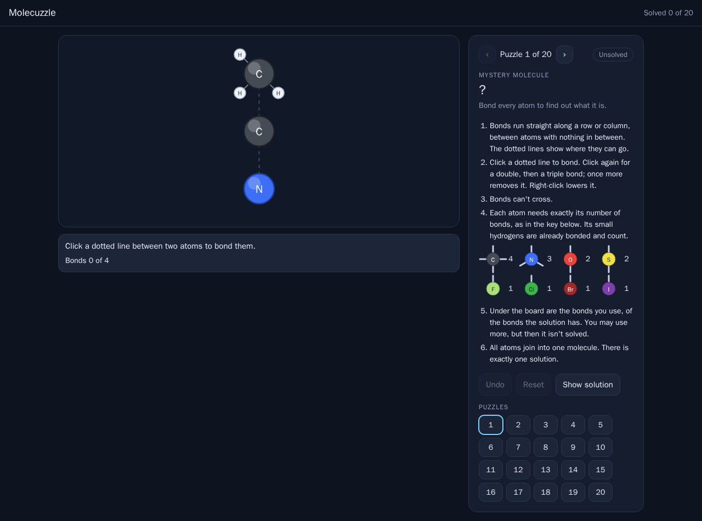
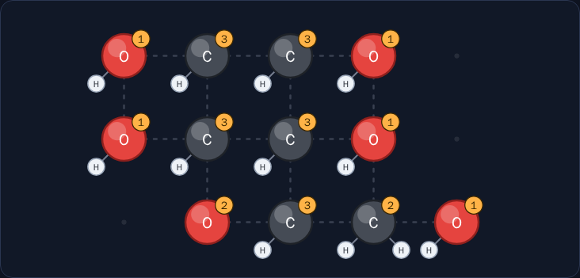
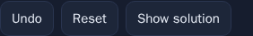
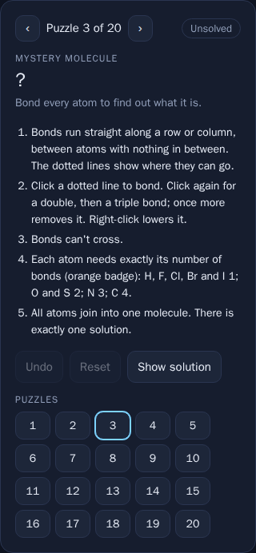

# UI

What the Player sees and does, on the one page of the game. It shows the [Puzzle](puzzle.md)s and their rules, and what [Storage](storage.md) keeps in the browser.

The screenshots show how the page looks at 1280×800, or 390×844 for a phone; a test compares the page with each of them, pixel for pixel with Playwright's default tolerance, in a container that is the same on every machine ([decision 0013](../decisions.md#0013)). Names in quotes are what a screen reader says.

## Page

### Page

- Parts: a header with "Molecuzzle" and "Solved <k> of <N>", N the number of Puzzles ([Puzzle.01](puzzle.md#puzzle)); the Board, with the status line below it and, in the same box, the counts line ([Board.05](#board)); and the panel, with the open Puzzle number, the mystery molecule heading and its title, the actions, its formula or "Bond every atom to find out what it is.", the rules and the Puzzles list, in that order, so the actions are in view on a phone (Page.01)

Example (Page.01), Puzzle 1 at the start, and Puzzle 3 solved:




### Layout

- Screens: wider than 820 px, the Board is left of the panel; narrower, the Board is above it; the page never scrolls sideways (Layout.01)
- Touch: tapping a Dotted line or Bond works as a click (Layout.02)

Example (Layout.01), on a phone:


## Board

### Board

- Drawing: each Atom is a ball with its Element's symbol: O red, N blue, C dark grey, S yellow, F light green, Cl green, Br dark red and I violet. Its hydrogens ([Puzzle.07](puzzle.md#puzzle)) are small white balls with an H, each on a short thin line from the Atom, on the diagonals below it and then the one above it on the left, where no Dotted line runs; they can't be clicked, and don't pulse with their Atom. A Dotted line is drawn dotted; a single, double and triple Bond as one, two and three lines (Board.01)
- Hidden: an Atom doesn't show what it needs ([Valence.01](puzzle.md#valence)): it has no badge, and it doesn't glow when it is complete ([Valence.02](puzzle.md#valence)); the Player counts its Bonds and hydrogens against the key of [Panel.05](#panel) ([decision 0025](../decisions.md#0025)) (Board.02)
- Solved: when the Player solves the Puzzle ([Check.04](puzzle.md#check)), the Atoms pulse, unless the browser asks for reduced motion; a Puzzle that opens solved ([Progress.06](storage.md#progress)) doesn't pulse (Board.03)
- Counts: under the Board, in the box of the status line and below its text, left aligned, a line "Bonds <used> of <budget>" ([Valence.03](puzzle.md#valence), [Puzzle.09](puzzle.md#puzzle)), a `role="img"` named "Bonds used, of the budget: <used> of <budget>"; it takes the colour of the status line, but is orange while the Player uses more than the budget, and is the same when the Puzzle is solved. The numbers of Atoms with too few or too many Bonds are not shown: they would change with every Bond and say at once whether it is right ([decision 0025](../decisions.md#0025)) (Board.05)
- Names: the Board is "Board, <rows> by <cols>"; each Atom "<Element> <place>", with the Element's name (Oxygen, Nitrogen, Carbon, Sulfur, Fluorine, Chlorine, Bromine, Iodine), and ", with <h> hydrogen(s)" after the place if it has any, and no word on what it needs; each Dotted line and Bond "<symbol> <place> to <symbol> <place>: <no, single, double or triple> bond" (Board.04)

Example (Board.01, Board.02, Board.05), Puzzle 2, Acetic acid, with C═O:


Example (Board.01, Board.02, Board.05), Puzzle 12, Glucose, with no Bonds:



Example (Board.02, Board.04):

```
Given Puzzle 2, Acetic acid, with C═O
Then the Atoms are "Oxygen 1,2", "Carbon 2,1, with 3 hydrogens", "Carbon 2,2" and "Oxygen 3,2, with 1 hydrogen"
And no Atom has a badge or glows
And the Dotted lines and Bonds are "O 1,2 to C 2,2: double bond", "C 2,1 to C 2,2: no bond"
  and "C 2,2 to O 3,2: no bond"
```

Example (Board.05), Puzzle 2, Acetic acid, budget 4:

```
Given no Bonds
Then the line is "Bonds 0 of 4"
When O≡C and C─OH are made
Then it is "Bonds 4 of 4", in the colour of the rest, although the Puzzle isn't solved
When C─OH is made a double Bond, and CH₃─C is made
Then it is "Bonds 6 of 4", in orange
```

### Input

- Click: clicking a Dotted line or Bond makes it stronger ([Bond.01–03](puzzle.md#bond)); right-clicking makes it weaker ([Bond.06](puzzle.md#bond)) (Input.01)
- Keys: Tab reaches each Dotted line and Bond; Enter or Space acts as a click, Backspace, Delete or - as a right-click; Ctrl+Z or Cmd+Z as Undo (Input.02)
- Actions: Undo ([Bond.08](puzzle.md#bond)), disabled with nothing to undo; Reset ([Bond.09](puzzle.md#bond)), disabled with no Bonds and nothing to undo; and Show solution (Input.03)
- Confirm: Show solution asks "Show the solution?", and only after OK shows it ([Help.01](puzzle.md#help)) (Input.04)
- Confirm reset: Reset asks "Reset this puzzle? Its bonds and undo history are removed.", and only after OK resets it, since that can't be undone ([Bond.09](puzzle.md#bond)) (Input.05)

Example (Input.01, Input.02):

```
Given Puzzle 1, Acetonitrile, with no Bonds
When the Player clicks C 2,1 to N 3,1 three times, then right-clicks it
Then it is a double Bond
When the Player tabs to it and presses Delete
Then it is a single Bond
When the Player presses Ctrl+Z
Then it is a double Bond
```

Example (Input.05):

```
Given Puzzle 2, Acetic acid, with CH₃ 2,1 to C 2,2
When the Player clicks Reset and cancels
Then CH₃ 2,1 to C 2,2 is still there, and Undo is enabled
When the Player clicks Reset and confirms
Then there are no Bonds, and Undo is disabled
```

Example (Input.03), with Bonds and something to undo:



### Messages

- Status: after every change, the status line below the Board says, for each status ([Check](puzzle.md#check), [Help](puzzle.md#help)), the text in the table below; solved and revealed in green, pieces in orange (Messages.01)
- No Bond: when a Bond isn't made, a message shows for a moment: "Bonds can't cross." for `crossing` ([Bond.05](puzzle.md#bond)) (Messages.02)

| Status | Text |
|---|---|
| empty | Click a dotted line between two atoms to bond them. |
| open | Not every atom has the right number of bonds yet. |
| pieces | Every atom has its bonds, but they form more than one molecule. Everything must join up. |
| solved | ✓ Solved! It's <name>. |
| revealed | Here is <name>. Reset and build it yourself to mark it solved. |

Example (Messages.01):

```
Given Puzzle 2, Acetic acid, with no Bonds
Then the status line is "Click a dotted line between two atoms to bond them."
When the Player bonds CH₃ 2,1 to C 2,2
Then it is "Not every atom has the right number of bonds yet."
```

Example (Messages.02):

```
Given the Grid of the Grid.02 example, a made-up one, with a Bond CH₂ 2,1 to CH₂ 2,3
When the Player clicks the Dotted line O 1,2 to O 3,2
Then the message is "Bonds can't cross."
```

## Panel

### Panel

- Puzzle: "Puzzle <n> of <N>" between ‹ and ›, which open the previous and next Puzzle; ‹ is disabled on Puzzle 1 and › on the last. Next to it, "Unsolved" or "✓ Solved" (Panel.01)
- Mystery: under the heading "Mystery molecule", until the Board is solved or shows the solution, the panel shows "?" and "Bond every atom to find out what it is." (Panel.02)
- Named: once it is, in their place the Molecule's name and its formula with subscripts, and below them its fact and "Next puzzle →", which opens the next Puzzle (not on the last) (Panel.03)
- Rules: the panel lists the rules of the game, as in the screenshots; the one on valence points to the key: "Each atom needs exactly its number of bonds, as in the key below. Its small hydrogens are already bonded and count.", and a rule after it on the counts: "Under the board are the bonds you use, of the bonds the solution has. You may use more, but then it isn't solved." (Panel.04)
- Key: after the rule on valence, a key of the Elements the Puzzles use, C, N, O and S, each as a ball drawn as on the Board with its symbol, and as many short sticks round it as its number of bonds, 4, 3, 2 and 2, with that number beside it, named "<Element>: <n> bond(s)" ([table of valences](puzzle.md#board)); it gets its numbers from the Glue, and the sticks are as many as that number; it wraps on a phone (Panel.05)

Example (Panel.01, Panel.02, Panel.04, Panel.05), Puzzle 2, unsolved:



Example (Panel.01, Panel.03), Puzzle 3, solved:


Example (Panel.01):

```
Given Puzzle 1 is open
Then ‹ is disabled
When the Player clicks › and then opens Puzzle 20
Then "Puzzle 20 of 20" and "Unsolved" show, and › is disabled
```

### List

- Buttons: per Puzzle a button with its number, and ✓ if solved ([Progress.01](storage.md#progress)), named "Puzzle <n>", or "Puzzle <n>: <name>, solved" once it is; the open Puzzle is marked, and clicking a button opens its Puzzle (List.01)
- Score: the header shows "Solved <k> of <N>", k the Puzzles in the game that are solved (List.02)

Example (List.01), Puzzle 1 solved and Puzzle 3 open:


Example (List.01, List.02):

```
Given Puzzle 1 is solved
When the Player opens the game
Then the list has "Puzzle 1: Acetonitrile, solved", "Puzzle 2", "Puzzle 3", and the header "Solved 1 of 20"
When the Player clicks "Puzzle 13"
Then Puzzle 13 opens
```
