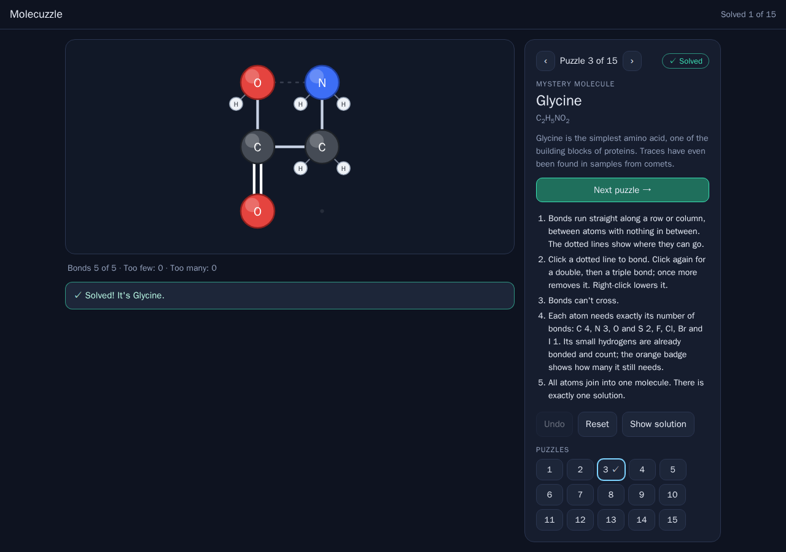
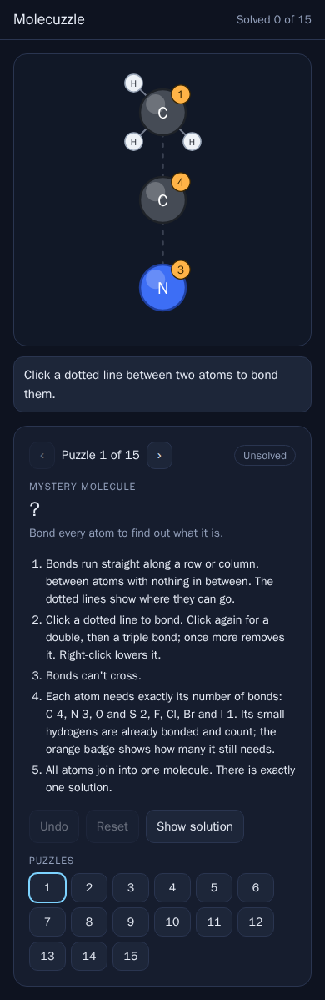
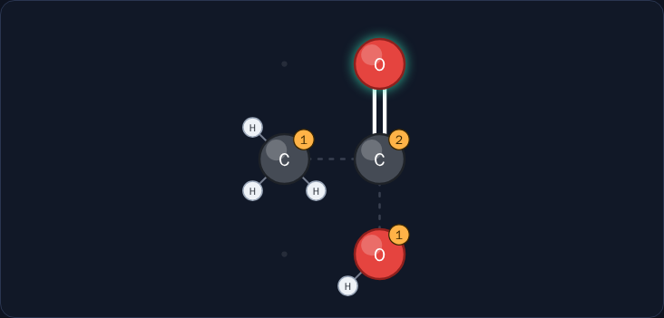
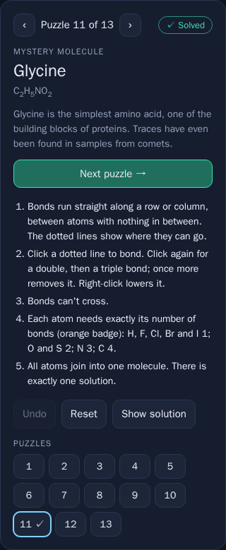
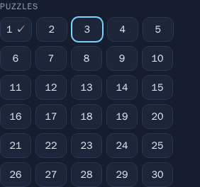

# UI

What the Player sees and does, on the one page of the game. It shows the [Puzzle](puzzle.md)s and their rules, and the [Data](data.md) kept in the browser.

The screenshots show how the page looks at 1280×800, or 390×844 for a phone; a test compares the page with each of them, pixel for pixel, in a container that is the same on every machine ([0013](../decisions.md#0013)). Names in quotes are what a screen reader says.

## Page

### Page

- Parts: a header with "Molecuzzle" and "Solved <k> of 13"; the Board, with the status line below it; and the panel, with the open Puzzle, the rules, the actions and the Puzzles list (Page.01)

Example (Page.01), Puzzle 1 at the start, and Puzzle 11 solved:




### Layout

- Screens: wider than 820 px, the Board is left of the panel; narrower, the Board is above it; the page never scrolls sideways (Layout.01)
- Touch: tapping a Dotted line or Bond works as a click (Layout.02)

Example (Layout.01), on a phone:



## Board

### Board

- Drawing: each Atom is a ball with its Element's symbol: H white, O red, N blue, C dark grey. A Dotted line is drawn dotted; a single, double and triple Bond as one, two and three lines (Board.01)
- Needs: each Atom that needs Bonds ([Valence.01](puzzle.md#valence)) shows an orange badge with how many; a complete Atom ([Valence.02](puzzle.md#valence)) glows and has no badge (Board.02)
- Solved: when the Puzzle is solved ([Check.04](puzzle.md#check)), the Atoms pulse, unless the browser asks for reduced motion (Board.03)
- Names: the Board is "Board, <rows> by <cols>"; each Atom "<Element> <place>: needs <n> more bond(s)" or "<Element> <place>: complete", with the Element's name (Hydrogen, Oxygen, Nitrogen, Carbon); each Dotted line and Bond "<symbol> <place> to <symbol> <place>: <no, single, double or triple> bond" (Board.04)

Example (Board.01, Board.02), Puzzle 3, Formaldehyde, with C═O:



Example (Board.04):

```
Given Puzzle 3, Formaldehyde, with C═O
Then the Atoms are "Hydrogen 1,1: needs 1 more bond", "Carbon 2,1: needs 2 more bonds",
  "Hydrogen 2,2: needs 1 more bond" and "Oxygen 3,1: complete"
And the Dotted lines and Bonds are "H 1,1 to C 2,1: no bond", "C 2,1 to H 2,2: no bond"
  and "C 2,1 to O 3,1: double bond"
```

### Input

- Click: clicking a Dotted line or Bond makes it stronger ([Bond.01–03](puzzle.md#bond)); right-clicking makes it weaker ([Bond.06](puzzle.md#bond)) (Input.01)
- Keys: Tab reaches each Dotted line and Bond; Enter or Space acts as a click, Backspace, Delete or - as a right-click; Ctrl+Z or Cmd+Z as Undo (Input.02)
- Actions: Undo ([Bond.08](puzzle.md#bond)), disabled with nothing to undo; Reset ([Bond.09](puzzle.md#bond)), disabled with no Bonds and nothing to undo; and Show solution (Input.03)
- Confirm: Show solution asks "Show the solution?", and only after OK shows it ([Help.01](puzzle.md#help)) (Input.04)
- Confirm reset: Reset asks "Reset this puzzle? Its bonds and undo history are removed.", and only after OK resets it, since that can't be undone ([Bond.09](puzzle.md#bond)) (Input.05)

Example (Input.01, Input.02):

```
Given Puzzle 4, H·C·N
When the Player clicks C·N three times, then right-clicks it
Then it is C═N
When the Player tabs to it and presses Delete
Then it is C─N
When the Player presses Ctrl+Z
Then it is C═N
```

Example (Input.05):

```
Given Puzzle 2, Ammonia, with H 1,1 to N 2,1
When the Player clicks Reset and cancels
Then H 1,1 to N 2,1 is still there, and Undo is enabled
When the Player clicks Reset and confirms
Then there are no Bonds, and Undo is disabled
```

Example (Input.03), with Bonds and something to undo:


### Messages

- Status: after every change, the status line below the Board says, for each status ([Check](puzzle.md#check), [Help](puzzle.md#help)), the text in the table below; solved and revealed in green, pieces in orange (Messages.01)
- No Bond: when a Bond isn't made, a message shows for a moment: "<Element> already has all its bonds." for `full` ([Bond.04](puzzle.md#bond)), with the Element's name, and "Bonds can't cross." for `crossing` ([Bond.05](puzzle.md#bond)) (Messages.02)

| Status | Text |
|---|---|
| empty | Click a dotted line between two atoms to bond them. |
| open | <N> atom(s) still need(s) bonds. |
| pieces | Every atom has its bonds, but they form more than one molecule. Everything must join up. |
| solved | ✓ Solved! It's <name>. |
| revealed | Here is <name>. Reset and build it yourself to mark it solved. |

Example (Messages.01):

```
Given Puzzle 2, Ammonia, with no Bonds
Then the status line is "Click a dotted line between two atoms to bond them."
When the Player bonds H 1,1 to N 2,1
Then it is "3 atoms still need bonds."
```

Example (Messages.02):

```
Given Puzzle 5, Methanol, with a Bond H 3,1 to H 3,2
When the Player clicks the Dotted line O 2,1 to H 3,1
Then the message is "Hydrogen already has all its bonds."
```

## Panel

### Panel

- Puzzle: "Puzzle <n> of 13" between ‹ and ›, which open the previous and next Puzzle; ‹ is disabled on Puzzle 1 and › on Puzzle 13. Next to it, "Unsolved" or "✓ Solved" (Panel.01)
- Mystery: under the heading "Mystery molecule", until the Board is solved or shows the solution, the panel shows "?" and "Bond every atom to find out what it is." (Panel.02)
- Named: once it is, in their place the Molecule's name and its formula with subscripts, and below them its fact and "Next puzzle →", which opens the next Puzzle (not on Puzzle 13) (Panel.03)
- Rules: the panel lists the rules of the game, as in the screenshots (Panel.04)

Example (Panel.01, Panel.02, Panel.04), Puzzle 3, unsolved:


Example (Panel.01, Panel.03), Puzzle 11, solved:



Example (Panel.01):

```
Given Puzzle 1 is open
Then ‹ is disabled
When the Player clicks › and then opens Puzzle 13
Then "Puzzle 13 of 13" and "Unsolved" show, and › is disabled
```

### List

- Buttons: per Puzzle a button with its number, and ✓ if solved ([Progress.01](data.md#progress)), named "Puzzle <n>", or "Puzzle <n>: <name>, solved" once it is; the open Puzzle is marked, and clicking a button opens its Puzzle (List.01)
- Score: the header shows "Solved <k> of 13" (List.02)

Example (List.01), Puzzle 1 solved and Puzzle 3 open:



Example (List.01, List.02):

```
Given Puzzle 1 is solved
When the Player opens the game
Then the list has "Puzzle 1: Water, solved", "Puzzle 2", "Puzzle 3", and the header "Solved 1 of 13"
When the Player clicks "Puzzle 13"
Then Puzzle 13 opens
```
